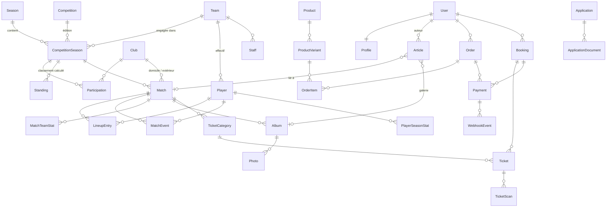

# Phase 0 — Proposition d'architecture (révision 2)

> Projet : plateforme web de **Precis FC** (nom, logo, couleurs, stade… configurables depuis l'administration).
> Révision 2 du 15 octobre 2026, qui intègre vos réponses : Côte d'Ivoire et FCFA, MySQL (WAMP en local), hébergement mutualisé **cPanel chez LWS**, un seul agrégateur de paiement dans la prochaine version.
> Versions vérifiées le jour même sur PyPI et npm.
> Statut : **en attente de validation finale** (voir §8).

---

## 1. Architecture technique recommandée

### 1.1 Contraintes de l'hébergement cPanel (LWS)

Un hébergement mutualisé cPanel ne permet pas d'utiliser une partie de l'infrastructure prévue par le cahier des charges. L'architecture est donc conçue pour **fonctionner pleinement sur cPanel** et pour **passer sur un VPS sans réécriture** le jour où le club en aura besoin.

| Prévu au cahier des charges | Possible sur cPanel mutualisé ? | Solution retenue |
|---|---|---|
| PostgreSQL | Non | **MySQL / MariaDB** (InnoDB, utf8mb4) |
| Gunicorn + Nginx | Non : Apache/LiteSpeed et **Phusion Passenger** sont imposés par l'outil « Setup Python App » | `passenger_wsgi.py` + `.htaccess`. Les fichiers Gunicorn et Nginx sont fournis en plus pour un futur VPS. |
| Redis (cache) | Rarement disponible | **Cache en base de données** (partagé entre les processus Passenger). Redis s'active par simple variable d'environnement sur un VPS. |
| Celery (worker permanent) | Non : les processus longs sont arrêtés | Les tâches sont écrites comme des tâches Celery, mais exécutées **de façon synchrone** (`CELERY_TASK_ALWAYS_EAGER=True`). Les traitements périodiques passent par des **tâches cron cPanel**. Une variable suffit pour activer un vrai worker sur VPS. |
| Django Channels (WebSocket) | Non | Déjà prévu en V2 ; nécessitera un VPS. |
| Docker | Non | Retiré du MVP. Développement local avec WAMP. |
| HTTPS | Oui (AutoSSL / Let's Encrypt de cPanel) | Cookies sécurisés et HSTS activés après validation du HTTPS |
| Tâches planifiées | Oui (cron cPanel) | Commande `run_scheduled_jobs` toutes les 5 minutes, sauvegarde quotidienne |

### 1.2 Vue d'ensemble (production cPanel)

```
                    ┌──────────────────────────── Navigateur ─────────────────────────────┐
                    │ Templates Django + Bootstrap 5.3 + jQuery 3.7 (+ HTMX ponctuel)     │
                    └───────────────▲─────────────────────────────────▲───────────────────┘
                                    │ HTTPS (AutoSSL)                 │ HTTPS (JSON)
                    ┌───────────────┴─────────────────────────────────┴───────────────────┐
                    │ Apache / LiteSpeed (LWS)                                             │
                    │  ─ /static/ et /media/ servis directement depuis public_html         │
                    │  ─ le reste est transmis à Passenger                                 │
                    └───────────────┬──────────────────────────────────────────────────────┘
                                    │ WSGI
                    ┌───────────────▼──────────────────────────┐
                    │ Passenger → Django 5.2 (virtualenv cPanel)│
                    │  ─ Site public (vues + templates, sessions)
                    │  ─ Tableau de bord du club (/gestion/)
                    │  ─ Django Admin (URL non devinable)
                    │  ─ API REST DRF (/api/v1/) + OpenAPI
                    │  ─ Webhooks paiement (V2)
                    └───────┬──────────────────────┬────────────┘
                            │                      │
              ┌─────────────▼─────────────┐  ┌─────▼────────────────────────────────┐
              │ MySQL / MariaDB (cPanel)  │  │ Disque de l'hébergement              │
              │ données, sessions, cache, │  │  public_html/media   → médias publics │
              │ verrous de ligne (InnoDB) │  │  ~/precisfc_private  → candidatures,  │
              └─────────────▲─────────────┘  │                       pièces jointes  │
                            │                └───────────────────────────────────────┘
              ┌─────────────┴─────────────┐
              │ Cron cPanel               │  expiration des réservations, envoi de la
              │ manage.py run_scheduled_jobs│ newsletter par lots, nettoyage, sauvegarde
              └───────────────────────────┘
```

### 1.3 Choix structurants (et justification)

| Sujet | Décision | Pourquoi |
|---|---|---|
| Version de Django | **Django 5.2 LTS (5.2.18)** et non 6.1 | `django-auditlog` (obligatoire) ne déclare que jusqu'à Django 5.2, et `django-axes`, `django-tables2` et `whitenoise` s'arrêtent à 6.0. La 5.2 LTS est supportée jusqu'en **avril 2028**. Elle accepte aussi Python 3.10 à 3.13, ce qui laisse de la marge face aux versions proposées par LWS. |
| Python | **La même version mineure en local et chez LWS** (3.13 si LWS la propose, sinon 3.12 ou 3.11) | Évite les écarts de dépendances. **À confirmer dans votre cPanel** (§8). |
| Base de données | **MySQL/MariaDB, InnoDB, `utf8mb4` / `utf8mb4_unicode_ci`, mode strict, isolation READ COMMITTED** | Utilisable chez LWS. utf8mb4 gère les accents et les emojis. Le mode strict refuse les données tronquées. InnoDB fournit les transactions et les verrous de ligne (`select_for_update`). |
| Moteur local | **MariaDB** comme chez LWS (11.4.10). En local : MariaDB 11.5.2 de WAMP (port 3307), ou de préférence l'add-on WAMP **MariaDB 11.4.x** pour avoir exactement la même branche LTS | Ce qui est testé en local est ce qui tournera en production. |
| Jeu de caractères | Le serveur LWS est en **latin1** par défaut. La base est donc **convertie en `utf8mb4_unicode_ci` juste après sa création** (phpMyAdmin → Opérations → Interclassement), et Django force `charset=utf8mb4` sur chaque connexion. Un test automatique vérifie le jeu de caractères de la base. | Sans cela, les accents et les emojis seraient corrompus. |
| Pilote MySQL | **mysqlclient 2.3.0** (pilote officiel de Django ; roue précompilée sous Windows), avec **repli automatique sur PyMySQL 1.2.3** (pur Python) | Sous Linux, mysqlclient doit être compilé, ce qui échoue parfois sur un hébergement mutualisé. PyMySQL s'installe partout. Les deux seront testés en local. |
| Modèle utilisateur | **Utilisateur personnalisé** (`accounts.User`, connexion par e-mail) dès la première migration | Impossible à changer proprement après coup. |
| Rendu | Server-side (templates) + jQuery ; HTMX seulement là où il simplifie | Conforme au cahier des charges, fonctionne sans JavaScript pour l'essentiel. |
| Tâches asynchrones | Tâches Celery (`@shared_task`), exécutées en synchrone sur cPanel ; travaux périodiques via `run_scheduled_jobs` (cron) | Le même code fonctionne sur cPanel et sur VPS. Les envois massifs (newsletter) partent **par lots via cron**, jamais pendant une requête. |
| Cache | `DatabaseCache` sur cPanel, Redis sur VPS (`CACHE_URL`) ; aucun cache de page pour les utilisateurs connectés | Le cahier des charges interdit de mélanger les données privées de plusieurs utilisateurs. |
| Fichiers statiques | `collectstatic` vers `public_html/static`, servi directement par Apache avec en-têtes de cache ; whitenoise en secours | Plus rapide que de passer par Python. |
| Authentification API | Sessions + CSRF pour le site ; `TokenAuthentication` DRF réservé aux clients externes de confiance (ex. application de contrôle des billets) | Pas de JWT, conformément au cahier des charges. |
| Rôles | Groupes et permissions Django, créés par la commande idempotente `setup_roles` ; règles par objet (auteur d'un article, entraîneur de son équipe) dans des classes de permission dédiées | Couvre les besoins sans dépendance supplémentaire. |
| Éditeur de contenu | **django-prose-editor** (Tiptap, licence BSD/MIT) avec assainissement HTML via `nh3` | Licence permissive et protection contre le XSS. |
| Images | Pillow + **django-imagekit** (miniatures WebP générées au téléversement), taille maximale configurable (8 Mo par défaut) | Respecte les limites mémoire d'un hébergement mutualisé. |
| PDF | **ReportLab** | Pur Python, s'installe sous Windows comme chez LWS. |
| QR code des billets | `qrcode` + **jeton signé HMAC** ; validation par un `UPDATE … WHERE status='VALID'` atomique | Un billet falsifié est rejeté, et un billet ne peut pas être validé deux fois, même en cas de scans simultanés. |
| Concurrence (stocks, billets) | `transaction.atomic()` + `select_for_update()` (InnoDB) ; réservations « en attente » qui expirent après 15 min | Empêche la survente et les doubles réservations. |
| Paiements | **V1 :** couche d'adaptateurs `PaymentProvider`, un fournisseur *sandbox* (démonstration et tests) et un fournisseur **« paiement manuel »** : espèces au guichet, retrait sur place ou dépôt Mobile Money, confirmés par un responsable habilité dans le tableau de bord, avec traçabilité. **V2 :** un agrégateur (CinetPay, PayDunya…) branché sur la même interface, avec webhooks signés. | Le site sera utilisable pour de vraies ventes dès la V1, sans contrat marchand. L'agrégateur s'ajoute ensuite sans modifier la boutique ni la billetterie. |
| Recherche | `icontains` avec index, et repli sur les index FULLTEXT de MySQL si le volume l'exige | La recherche plein texte de PostgreSQL n'est pas disponible. Le volume d'un club reste modeste. |
| Publication programmée | Calculée à la requête (`status=PUBLISHED and publish_at <= now`) | Un article programmé s'affiche à l'heure prévue, sans tâche planifiée. |
| Classements | Calculés par un **service** à partir des matchs terminés, puis stockés dans une table `Standing` ; règles de départage configurables par compétition ; ajustements de points | Lectures rapides et calcul testable. |
| Sécurité connexion | **django-axes** (blocage après N échecs, stockage en base), hachage **Argon2**, vérification de l'e-mail (allauth) | Section 22 du cahier des charges. |
| Antispam formulaires | Champ piège (honeypot), délai minimal de soumission, limitation de débit par IP (cache en base) | Aucun service tiers. |
| Fichiers sensibles | Stockage privé **hors de `public_html`**, accessible uniquement via une vue qui contrôle les permissions | Apache ne peut pas servir ces fichiers directement. |
| Bibliothèques frontend | Hébergées localement dans `static/vendor/` | CSP stricte, aucune dépendance à un CDN. |
| E-mails | SMTP d'une boîte mail du domaine créée sur cPanel (LWS) | Pas de service externe nécessaire. |

---

## 2. Périmètre : MVP (V1) et versions ultérieures

### 2.1 MVP — V1 (étapes 1 à 16)

| Module | Inclus dans le MVP |
|---|---|
| **Identité du club** | Paramètres globaux (nom, logo, couleurs, slogan, coordonnées, réseaux sociaux, FCFA, SEO par défaut), bannières d'accueil, pages institutionnelles (histoire, mission/vision/valeurs, identité visuelle), palmarès et trophées, présidents successifs, organigramme, infrastructures (stade, centre d'entraînement, centre de formation). |
| **Équipes et personnes** | Équipes par catégorie (première, féminine, réserve, U21, U18, U15…, académie), joueurs (fiche complète et règles de confidentialité pour les mineurs), staff technique, joueurs vedettes. |
| **Compétitions et matchs** | Saisons, compétitions (championnat, coupe, continentale, internationale, amical), clubs adverses, matchs (statuts, reports avec historique d'horaire), compositions, événements, statistiques d'équipe, compte rendu, filtres, recherche, export PDF du calendrier, calendrier `.ics`. |
| **Classements et statistiques** | Classement calculé avec départage configurable, ajustements de points, buteurs, passeurs, meilleures attaques et défenses, statistiques de saison des joueurs, graphiques Chart.js. |
| **Actualités** | 9 types de contenus, catégories, tags, éditeur riche, image principale, galerie liée, workflow **brouillon → en relecture → programmé / publié → archivé**, prévisualisation, articles liés, recherche, pagination, partage social, SEO, historique des modifications (auditlog). |
| **Médias** | Albums (match, saison, entraînement, joueurs, événements), photos avec miniatures WebP et visionneuse, vidéos intégrées (YouTube, Vimeo, Dailymotion), filtres. |
| **Boutique** | Catalogue, catégories, fiches produit avec plusieurs photos, variantes taille/couleur avec SKU et stock, mouvements de stock, prix promotionnels datés, liste de souhaits, panier (invité ou connecté), codes promo, zones et frais de livraison (Abidjan, intérieur du pays, retrait au club), commande, facture PDF, historique, suivi du statut, demandes de retour. |
| **Paiements** | Architecture d'adaptateurs ; fournisseur *sandbox* ; **paiement manuel** confirmé par une personne habilitée (traçabilité complète, audit) ; aucune donnée de carte stockée. |
| **Billetterie** | Matchs en vente, catégories de places, prix, quotas, réservation avec blocage temporaire, paiement (manuel en V1), billet PDF avec QR signé, historique, annulation selon les conditions, **interface de contrôle** pour les agents (scan par caméra du téléphone ou saisie du code), journal des scans, anti-réutilisation. |
| **Académie** | Présentation, catégories d'âge, programme, staff, infrastructures, calendrier des activités, actualités, conditions d'admission, formulaire de candidature (représentant légal obligatoire pour les mineurs, documents privés, consentement), suivi des candidatures réservé aux personnes habilitées, durée de conservation. |
| **Partenaires** | 5 niveaux de partenariat, logo, description, URL, ordre, dates de début et de fin. |
| **Espace supporters** | Inscription, connexion, vérification de l'e-mail, mot de passe oublié, profil, adresses, préférences de notification, newsletter, commandes, billets, favoris. |
| **Contact** | Page contact avec carte du stade (OpenStreetMap, sans clé API), formulaires contact, partenariat et recrutement sportif, FAQ, newsletter avec double confirmation, antispam. |
| **Tableau de bord** | Indicateurs de la section 15 (chiffre d'affaires calculé uniquement sur les paiements confirmés), graphiques, raccourcis par rôle, tables DataTables, saisie rapide des scores, confirmation des paiements manuels, gestion des commandes, des billets et des candidatures. Django Admin pour l'administration complète. |
| **Rôles** | Les 13 rôles de la section 16, appliqués côté serveur. |
| **API REST** | `/api/v1/` : lecture publique et endpoints authentifiés (profil, commandes, billets, contrôle des billets) ; filtres, recherche, tri, pagination, limitation de débit, erreurs homogènes, OpenAPI (Swagger et ReDoc). |
| **SEO** | Métadonnées par objet, Open Graph, sitemap XML, robots.txt, URL canoniques, fil d'Ariane, Schema.org, pages 403/404/500. |
| **Exploitation** | Déploiement cPanel documenté pas à pas, cron, sauvegarde et restauration (mysqldump + archive des médias), procédure de mise à jour et de retour arrière ; fichiers Gunicorn et Nginx pour un futur VPS. |

### 2.2 Versions ultérieures

| Fonctionnalité | Raison du report |
|---|---|
| **Paiement en ligne via un agrégateur** (Orange Money, MTN MoMo, Wave, carte) | Votre choix : V2. L'interface est prête dès la V1. |
| Match center en direct (Django Channels, WebSocket) | Exige un VPS et une source de données fiable. |
| Worker Celery permanent et cache Redis | Exige un VPS ; activable par configuration. |
| Commentaires modérés sur les articles | Optionnel dans le cahier des charges. |
| Abonnements saisonniers, choix de place sur plan du stade | Demande une modélisation du stade par place. |
| Site multilingue (anglais) | Chaînes marquées pour la traduction dès la V1. |
| Notifications push ou SMS, PWA, application mobile | L'API V1 sert de base. |
| Historique des effectifs saison par saison | En V1, l'historique passe par les statistiques par saison. |
| ACL fines par objet (django-guardian) | Si les règles par objet de la V1 ne suffisent plus. |
| Fidélité, carte de membre, campagnes newsletter avancées | Fonctions commerciales à définir. |
| Stockage S3 des médias | Inutile tant que le disque de l'hébergement suffit. |

---

## 3. Schéma initial de la base de données

Conventions : toutes les tables héritent de `TimeStampedModel` (`created_at`, `updated_at`). Les objets publics ont un `slug` unique et des champs SEO (`meta_title`, `meta_description`, `og_image`). Les montants sont en `DecimalField(12, 2)` en **FCFA (XOF)**, affichés sans décimales (ex. « 15 000 FCFA »). Le fuseau horaire est `Africa/Abidjan` (UTC+0, sans heure d'été). Les index portent sur les colonnes filtrées.

Points propres à MySQL :
- `VARCHAR(255)` maximum pour les colonnes indexées (limite d'index InnoDB en utf8mb4 respectée).
- La collation `_ci` rend l'unicité **insensible à la casse** (e-mails, codes promo), ce qui est le comportement voulu.
- Les contraintes `CHECK` sont appliquées par MySQL ≥ 8.0.16 et MariaDB ≥ 10.2 ; toutes sont **également validées dans les formulaires et les services**.
- `JSONField` est disponible avec les deux moteurs.

### 3.1 `core` — identité et pages du club

| Modèle | Champs principaux |
|---|---|
| `ClubSettings` *(singleton)* | name (« Precis FC »), short_name, slogan, logo, logo_dark, favicon, color_primary (bleu marine), color_secondary (or), color_light (gris clair), founded_year, home_stadium → Facility, address, phone, email, map_lat, map_lng, réseaux sociaux (Facebook, X, Instagram, YouTube, TikTok, LinkedIn), currency (XOF), default_meta_description, default_og_image, about_short |
| `HeroSlide` | title, subtitle, image, cta_label, cta_url, order, is_active, starts_at, ends_at |
| `Page` | section (history, mission, identity, sporting_direction, training_centre…), title, slug, body (HTML assaini), cover, order, is_published, SEO |
| `Value` | title, description, icon, order |
| `Trophy` / `TrophyWin` | name, competition_name, category, image, order / trophy, season_label, year, notes |
| `President` | full_name, photo, start_year, end_year, bio, order |
| `OrgMember` | full_name, photo, role_title, department (direction, administration, sportive, médical, communication…), bio, order, is_published |
| `Facility` / `FacilityPhoto` | name, slug, kind (stadium, training_centre, academy, office), description, capacity, address, lat, lng, cover |

### 3.2 `accounts` — comptes et profils

| Modèle | Champs principaux |
|---|---|
| `User` *(AbstractUser)* | email (unique, identifiant de connexion), first_name, last_name, is_active, date_joined |
| `Profile` | user (1-1), phone (format CI +225), avatar, city, country, birth_date (facultatif), notify_news, notify_matches, notify_shop, notify_tickets |
| `Address` | user, label, full_name, phone, line1, line2, commune, city, country, is_default |

### 3.3 `teams` — équipes, joueurs, staff

| Modèle | Champs principaux |
|---|---|
| `Team` | name, slug, category (FIRST, WOMEN, RESERVE, U21, U18, U17, U15, U13, ACADEMY), gender, description, image, season → Season, head_coach → Staff, order, is_published |
| `Player` | team, first_name, last_name, slug, photo, shirt_number, position (GK, DF, MF, FW), detailed_position, nationality, birth_date, height_cm, weight_kg, preferred_foot, bio, joined_on, is_featured, is_published, **show_birth_date**, **show_physical**, **publication_consent**, consent_by, consent_date |
| `PlayerPhoto` | player, image, caption, order |
| `Staff` | team (facultatif), first_name, last_name, slug, photo, role (HEAD_COACH, ASSISTANT, GK_COACH, FITNESS, DOCTOR, PHYSIO, ANALYST, ACADEMY_MANAGER…), bio, nationality, joined_on, user (facultatif), order, is_published |

Règle de confidentialité : un joueur mineur sans `publication_consent` n'apparaît pas sur le site public. Avec consentement, seule son année de naissance est affichée.

### 3.4 `competitions` — saisons, compétitions, classements

| Modèle | Champs principaux |
|---|---|
| `Season` | name (« 2026-2027 »), slug, start_date, end_date, is_current (une seule) |
| `Club` | name, short_name, slug, logo, city, country, is_own_club |
| `Competition` | name, slug, kind (LEAGUE, CUP, CONTINENTAL, INTERNATIONAL, FRIENDLY), logo, country, points_win, points_draw, points_loss, **tiebreak_rules** (liste ordonnée JSON), has_standings |
| `CompetitionSeason` | competition, season, team → Team, participants via `Participation` |
| `Participation` | competition_season, club, group_name, points_adjustment, adjustment_reason |
| `Standing` *(calculé)* | competition_season, club, group_name, position, played, won, drawn, lost, goals_for, goals_against, goal_difference, points, form |
| `PlayerSeasonStat` *(calculé)* | player, season, competition_season, appearances, starts, minutes, goals, assists, yellow_cards, red_cards, clean_sheets |

### 3.5 `matches` — matchs, compositions, événements

| Modèle | Champs principaux |
|---|---|
| `Match` | competition_season, matchday / round_label, home_club, away_club, kickoff_at, original_kickoff_at, venue → Facility ou venue_name, status (SCHEDULED, LIVE, FINISHED, POSTPONED, CANCELLED), home_score, away_score, home_penalties, away_penalties, referee, assistant_referees, fourth_official, attendance, report, highlights_video, slug, is_published |
| `MatchScheduleChange` | match, old_kickoff_at, new_kickoff_at, reason, changed_by |
| `LineupEntry` | match, side, player ou player_name, shirt_number, position, is_starter, is_captain |
| `MatchEvent` | match, side, minute, added_time, kind (GOAL, PENALTY_GOAL, OWN_GOAL, MISSED_PENALTY, YELLOW, SECOND_YELLOW, RED, SUBSTITUTION), player / player_name, assist_player / assist_name, player_out / player_out_name, note |
| `MatchTeamStat` | match, side, possession, shots, shots_on_target, corners, fouls, offsides, saves |

Le service `recompute_match(match)` met à jour `Standing` et `PlayerSeasonStat` après validation de la transaction.

### 3.6 `news` — actualités

| Modèle | Champs principaux |
|---|---|
| `Category` / `Tag` | name, slug (, order) |
| `Article` | kind (9 types), title, slug, excerpt, body, cover_image, cover_alt, gallery → Album, category, tags, author, status (DRAFT, IN_REVIEW, SCHEDULED, PUBLISHED, ARCHIVED), publish_at, reviewed_by, reviewed_at, review_note, related_match, related_players, is_featured, preview_token, SEO |

### 3.7 `media_library` — photothèque et vidéothèque

| Modèle | Champs principaux |
|---|---|
| `Album` | title, slug, kind (MATCH, SEASON, TRAINING, PLAYERS, EVENT, ACADEMY), season, match, cover, event_date, is_published, published_at |
| `Photo` | album, image + déclinaisons WebP (thumb, medium, large), caption, alt_text, credit, order, width, height |
| `Video` | title, slug, kind, provider (YOUTUBE, VIMEO, DAILYMOTION), video_id (validé), thumbnail, description, match, season, published_at, is_published |

### 3.8 `shop` — catalogue et stocks

| Modèle | Champs principaux |
|---|---|
| `ProductCategory` | name, slug, parent, image, order |
| `Product` | category, name, slug, description, base_price, sale_price, sale_starts_at, sale_ends_at, is_active, is_featured, SEO |
| `ProductImage` | product, image, alt_text, order, color |
| `ProductVariant` | product, sku (unique), size, color, price_override, stock, low_stock_threshold, is_active |
| `StockMovement` | variant, delta, reason (PURCHASE, CANCEL, RETURN, ADJUSTMENT, RESTOCK), order_item, user, note |
| `WishlistItem` | user, product |

### 3.9 `orders` — panier, commandes, livraison

| Modèle | Champs principaux |
|---|---|
| `Cart` / `CartItem` | user ou session_key ; variant, quantity |
| `ShippingMethod` | name, description, zone_label, fee, free_above, delivery_days, is_pickup, is_active |
| `PromoCode` / `PromoRedemption` | code, kind (PERCENT, FIXED, FREE_SHIPPING), value, min_subtotal, starts_at, ends_at, max_uses, max_uses_per_user, used_count, is_active / promo, order, user |
| `Order` | number, user, email, phone, instantané de l'adresse, shipping_method, status (PENDING_PAYMENT, PAID, PROCESSING, SHIPPED, DELIVERED, CANCELLED, REFUNDED), subtotal, discount, shipping_fee, total, currency, promo_code, invoice_number, paid_at, tracking_number, expires_at |
| `OrderItem` | order, variant, instantané (product_name, sku, size, color, unit_price), quantity, line_total |
| `OrderStatusEvent` | order, from_status, to_status, note, actor |
| `ReturnRequest` | order, items, reason, status, resolution_note |

### 3.10 `payments` — paiements

| Modèle | Champs principaux |
|---|---|
| `Payment` | uuid, order *ou* booking (exactement un des deux, vérifié par contrainte et par le service), provider (SANDBOX, MANUAL, puis agrégateur en V2), method (CASH, MOBILE_MONEY_MANUAL, BANK_TRANSFER, CARD…), amount, currency, status (INITIATED, PENDING, SUCCEEDED, FAILED, CANCELLED, EXPIRED, REFUNDED), provider_reference (ex. n° de transaction Mobile Money saisi par l'agent), confirmed_by, confirmed_at, failure_reason |
| `WebhookEvent` | provider, event_id (unique), signature_valid, payload, received_at, processed_at, processing_error, payment — *table créée dès la V1, utilisée en V2* |

### 3.11 `ticketing` — billetterie et contrôle

| Modèle | Champs principaux |
|---|---|
| `TicketCategory` | match, name, description, price, capacity, max_per_order, sale_starts_at, sale_ends_at, is_active |
| `Booking` | reference, user, match, status (PENDING, CONFIRMED, CANCELLED, EXPIRED), expires_at, total, currency, cancelled_at, cancel_reason |
| `Ticket` | booking, category, holder_name, code (UUID), status (VALID, USED, CANCELLED), used_at, scanned_by, gate |
| `TicketScan` | ticket, raw_code, agent, result (OK, ALREADY_USED, INVALID, CANCELLED, WRONG_MATCH, EXPIRED), gate, scanned_at, ip |

### 3.12 `academy` — centre de formation

| Modèle | Champs principaux |
|---|---|
| `AgeCategory` | name, slug, min_birth_year, max_birth_year, description, team, order |
| `TrainingProgram` | title, slug, age_category, body, order |
| `AcademyEvent` | title, kind (TRAINING, TRIAL, TOURNAMENT, OPEN_DAY), starts_at, ends_at, location, age_category, description, is_published |
| `Application` | reference, identité du candidat, informations sportives, représentant légal (obligatoire si mineur), consentement, status (SUBMITTED, UNDER_REVIEW, TRIAL_INVITED, ACCEPTED, REJECTED, WITHDRAWN), internal_notes, reviewed_by, retention_until |
| `ApplicationDocument` | application, kind, file (**stockage privé**), original_name, size, content_type (vérifiés) |

### 3.13 `partners`, `contact`, `notifications`

| Modèle | Champs principaux |
|---|---|
| `partners.Partner` | name, slug, logo, tier (MAIN, OFFICIAL, TECHNICAL, MEDIA, INSTITUTIONAL), description, url, order, starts_on, ends_on, is_active |
| `contact.ContactMessage` | kind (GENERAL, PARTNERSHIP, RECRUITMENT, PRESS), name, email, phone, organisation, subject, message, attachment (privé), status, handled_by, ip_hash |
| `contact.FaqItem` | category, question, answer, order, is_published |
| `notifications.NewsletterSubscriber` | email, user, is_confirmed, confirm_token, confirmed_at, unsubscribed_at, source |
| `notifications.NewsletterCampaign` | subject, body, status (DRAFT, QUEUED, SENDING, SENT), sent_count, batch_size — envoyée par lots par le cron |
| `notifications.EmailLog` | to, template, subject, status, error |

### 3.14 Diagramme des relations principales



---

## 4. Arborescence du projet

```
precisfc/
├── manage.py
├── passenger_wsgi.py       # point d'entrée cPanel (Phusion Passenger)
├── requirements/
│   ├── base.txt            # dépendances communes, versions figées (==)
│   ├── dev.txt             # -r base.txt + outils de dev et de test
│   ├── cpanel.txt          # -r base.txt (+ PyMySQL si mysqlclient ne compile pas)
│   └── vps.txt             # -r base.txt + gunicorn, redis, django-redis (futur VPS)
├── pyproject.toml          # configuration ruff, pytest, coverage
├── .env.example
├── .gitignore
├── config/
│   ├── settings/
│   │   ├── base.py
│   │   ├── dev.py          # WAMP local
│   │   ├── test.py
│   │   └── prod.py         # cPanel (et VPS via variables d'environnement)
│   ├── urls.py
│   ├── wsgi.py
│   └── celery.py
├── apps/
│   ├── core/               # ClubSettings, pages, palmarès, infrastructures, SEO, sitemaps
│   │   ├── models.py  admin.py  views.py  urls.py  forms.py
│   │   ├── services.py  selectors.py  context_processors.py  sitemaps.py
│   │   ├── templatetags/
│   │   ├── management/commands/  # setup_roles, load_demo_data, run_scheduled_jobs, backup_db
│   │   ├── migrations/
│   │   └── tests/
│   ├── accounts/
│   ├── teams/
│   ├── competitions/       # + services/standings.py
│   ├── matches/
│   ├── news/
│   ├── media_library/
│   ├── shop/
│   ├── orders/             # + services/cart.py, checkout.py, pricing.py, invoice.py
│   ├── payments/
│   │   └── providers/      # base.py, sandbox.py, manual.py (agrégateur en V2)
│   ├── ticketing/          # + services/booking.py, scanning.py, pdf.py
│   ├── academy/
│   ├── partners/
│   ├── contact/
│   ├── notifications/
│   ├── dashboard/          # tableau de bord /gestion/
│   └── api/
│       └── v1/
├── templates/
│   ├── base.html
│   ├── partials/  components/  errors/  dashboard/
│   └── <app>/
├── static/
│   ├── css/  js/  img/
│   └── vendor/             # bootstrap, bootstrap-icons, jquery, swiper, chart.js, select2, datatables, htmx, html5-qrcode
├── media/                  # (ignoré par git) médias publics en local
├── private_media/          # (ignoré par git) fichiers privés en local
├── deploy/
│   ├── cpanel/             # .htaccess (static/media), guide pas à pas, lignes cron
│   ├── vps/                # gunicorn.conf.py, nginx.conf, unités systemd (option future)
│   └── scripts/            # backup.sh, restore.sh, deploy.sh, rollback.sh
├── docs/
└── tests/                  # tests transverses (sécurité, intégration)
```

Organisation sur l'hébergement LWS :

```
/home/<compte>/
├── precisfc/                    # code de l'application (hors public_html)
├── virtualenv/precisfc/3.x/     # créé par « Setup Python App »
├── precisfc_private/            # fichiers privés (candidatures…)
├── backups/                     # sauvegardes (rotation)
└── public_html/
    ├── .htaccess                # généré par cPanel (Passenger) + règles static/media
    ├── static/                  # collectstatic
    └── media/                   # médias publics
```

---

## 5. Versions des dépendances (vérifiées le 15/10/2026)

### 5.1 Backend

| Paquet | Version | Remarque |
|---|---|---|
| Django | **5.2.18** (LTS) | Python 3.10 à 3.13 |
| **mysqlclient** | **2.3.0** | Pilote officiel ; roue Windows cp313 disponible ; compilé chez LWS |
| **PyMySQL** | **1.2.3** | Repli pur Python si mysqlclient ne compile pas chez LWS |
| djangorestframework | 3.18.3 | |
| drf-spectacular | 0.30.0 | OpenAPI 3 |
| django-allauth | 65.19.7 | |
| django-filter | 26.2 | Exige Python ≥ 3.11 (sinon 25.x) |
| django-tables2 | 3.0.1 | Exige Python ≥ 3.11 |
| django-auditlog | 3.4.1 | Facteur limitant pour la version de Django |
| django-axes | 8.3.1 | |
| django-environ | 0.14.0 | |
| celery | 5.6.3 | Mode synchrone sur cPanel |
| django-celery-beat | — | **Non retenu** : remplacé par le cron cPanel |
| Pillow | 12.3.0 | |
| django-imagekit | 6.1.1 | |
| django-prose-editor / nh3 | 0.27.3 / 0.3.7 | |
| reportlab | 5.0.1 | |
| qrcode | 8.2 | |
| django-countries | 9.1.0 | |
| django-phonenumber-field + phonenumbers | 8.5.0 / 9.0.41 | Région par défaut : CI |
| django-csp | 4.0 | |
| django-htmx | 1.29.0 | |
| django-crispy-forms + crispy-bootstrap5 | 2.7 / 2026.9 | |
| argon2-cffi | 25.1.0 | |
| whitenoise | 6.12.0 | Secours pour les fichiers statiques |
| sentry-sdk | 2.72.0 | Facultatif |
| *VPS uniquement :* gunicorn, redis, django-redis | 26.2.0 / **6.4.0** / 7.0.0 | redis-py < 6.5 imposé par `kombu[redis]` |

**Dev et tests** : pytest-django 4.14.0, factory-boy 3.3.3, Faker 40.43.0, coverage 7.16.2, ruff 0.17.1, django-debug-toolbar 8.0.0.

La compatibilité réelle sera confirmée à l'étape 2 (`pip check`, `manage.py check`), puis par un **déploiement de test sur LWS dès l'étape 3**, pour détecter tôt les limites de l'hébergement plutôt qu'à la fin.

### 5.2 Frontend (hébergé dans `static/vendor/`)

| Bibliothèque | Version |
|---|---|
| Bootstrap | 5.3.8 |
| Bootstrap Icons | 1.13.2 |
| jQuery | **3.7.1** (la 4.0 existe, mais le cahier des charges impose 3.x) |
| Swiper | 14.3.0 |
| Chart.js | 4.5.1 |
| Select2 | 4.1.0 |
| DataTables (+ Bootstrap 5) | 2.3.8 |
| HTMX | 2.0.11 |
| html5-qrcode | 2.3.8 |

### 5.3 Services

| Service | Local (WAMP) | Production (LWS cPanel) |
|---|---|---|
| Base de données | MariaDB 11.5.2 (port 3307), ou l'add-on MariaDB 11.4.x | **MariaDB 11.4.10** (jeu de caractères serveur latin1 → base en utf8mb4) |
| Serveur web | `runserver` de Django | Apache/LiteSpeed + Passenger |
| Tâches périodiques | `python manage.py run_scheduled_jobs` à la main | Cron cPanel |
| E-mails | Affichés dans la console | SMTP de la boîte mail du domaine |

---

## 6. Plan de développement par étapes

Chaque étape se termine par : `python manage.py check`, `makemigrations --check`, `ruff`, **tous les tests verts sur MySQL/MariaDB**, et une démonstration. Nous ne passons à l'étape suivante qu'après votre validation.

| Étape | Contenu | Tests et critères de fin |
|---|---|---|
| **1** | Analyse et périmètre du MVP *(ce document)* | Votre validation |
| **2** | Dépôt Git, environnement virtuel, `requirements/`, projet `config` (réglages base/dev/test/prod), `pyproject.toml`, ruff | `pip check` sans conflit, `manage.py check` OK, serveur de dev démarré |
| **3** | Base MySQL/MariaDB (WAMP) en utf8mb4, `.env`, django-environ, statiques/médias, stockage privé, cache en base, Celery en mode synchrone, cron `run_scheduled_jobs`, journalisation, **déploiement de test « Hello Precis FC » sur LWS** | Connexion à la base et migrations, tests sur MySQL, accès refusé au stockage privé, page de test servie en HTTPS chez LWS |
| **4** | Création des 16 applications et de tous les modèles, migrations, admin de base, `ClubSettings` | Tests des modèles (contraintes, slugs, singleton), `makemigrations --check` |
| **5** | Utilisateur personnalisé, allauth, axes, Argon2, 13 rôles, classes de permission | Tests par rôle (accès autorisé et refusé), verrouillage, vérification de l'e-mail |
| **6** | Thème Bootstrap (couleurs depuis `ClubSettings`, mode sombre), gabarits communs, `app.js` (CSRF AJAX), pages d'erreur | Rendu des gabarits, contrastes, navigation sans JavaScript |
| **7** | Accueil et pages du club, SEO complet | Tests des vues, sitemap valide, nombre de requêtes SQL borné |
| **8** | Équipes, joueurs, staff, saisons, compétitions, matchs, événements, **classements et départages**, statistiques, export PDF/ICS | Jeux de tests de classement, confidentialité des mineurs, filtres |
| **9** | Actualités (workflow, prévisualisation, programmation, recherche), médias | Workflow par rôle, assainissement XSS, validation des téléversements, contenus programmés |
| **10** | Tableau de bord `/gestion/`, personnalisation de Django Admin | Indicateurs exacts, accès par rôle |
| **11** | API REST `/api/v1/` + OpenAPI | Permissions, filtres, pagination, limitation de débit, erreurs |
| **12** | Boutique, panier, liste de souhaits, codes promo, livraison, commande, facture PDF, retours | Prix et promotions, cohérence des stocks en concurrence, cycle de vie des commandes |
| **13** | Paiements (adaptateurs, sandbox, paiement manuel), billetterie (réservation, billet PDF + QR, contrôle) | Confirmation manuelle par rôle, **double réservation et double scan concurrents** sur InnoDB, expiration des réservations par le cron |
| **14** | Académie (candidatures, documents privés, rétention) et partenaires | Accès aux documents privés, représentant légal obligatoire pour un mineur, dates de partenariat |
| **15** | Sécurisation (`check --deploy`, CSP, en-têtes), optimisation (requêtes, index, cache), données de démonstration | `check --deploy` sans alerte, couverture ≥ 85 % sur les services critiques |
| **16** | Déploiement final sur LWS (Passenger, `.htaccess`, cron, SMTP, AutoSSL), sauvegarde et restauration, mise à jour et retour arrière, documentation finale, fichiers VPS | Site en production, restauration d'une sauvegarde testée |

---

## 7. Commandes d'installation

### 7.1 Windows (développement avec WAMP)

```powershell
# Prérequis : Python 3.x (même version mineure que chez LWS), Git, WAMP démarré
cd C:\MesProjets\precisfc
py -3.13 -m venv .venv
.\.venv\Scripts\Activate.ps1
python -m pip install --upgrade pip
pip install -r requirements\dev.txt
pip check

# Création de la base (MariaDB WAMP sur le port 3307 ; utiliser 3306 pour MySQL)
C:\wamp64\bin\mariadb\mariadb11.5.2\bin\mariadb.exe -u root -P 3307 -e "CREATE DATABASE precisfc CHARACTER SET utf8mb4 COLLATE utf8mb4_unicode_ci; CREATE USER 'precisfc'@'localhost' IDENTIFIED BY 'mot_de_passe_local'; GRANT ALL PRIVILEGES ON precisfc.* TO 'precisfc'@'localhost'; GRANT ALL PRIVILEGES ON test_precisfc.* TO 'precisfc'@'localhost'; FLUSH PRIVILEGES;"

Copy-Item .env.example .env           # puis renseigner DATABASE_URL, SECRET_KEY…
python manage.py migrate
python manage.py createcachetable
python manage.py setup_roles
python manage.py createsuperuser
python manage.py load_demo_data
python manage.py runserver

pytest
```

### 7.2 Linux (développement ou VPS futur)

```bash
sudo apt update && sudo apt install -y python3.13 python3.13-venv python3.13-dev \
     build-essential pkg-config default-libmysqlclient-dev mariadb-server git
python3.13 -m venv .venv && source .venv/bin/activate
python -m pip install --upgrade pip
pip install -r requirements/dev.txt && pip check

sudo mariadb -e "CREATE DATABASE precisfc CHARACTER SET utf8mb4 COLLATE utf8mb4_unicode_ci; \
  CREATE USER 'precisfc'@'localhost' IDENTIFIED BY 'mot_de_passe_local'; \
  GRANT ALL PRIVILEGES ON precisfc.* TO 'precisfc'@'localhost'; \
  GRANT ALL PRIVILEGES ON test_precisfc.* TO 'precisfc'@'localhost'; FLUSH PRIVILEGES;"

cp .env.example .env
python manage.py migrate && python manage.py createcachetable
python manage.py setup_roles && python manage.py createsuperuser
python manage.py load_demo_data
python manage.py runserver
pytest
```

### 7.3 Production LWS (cPanel), résumé (guide détaillé à l'étape 3)

1. cPanel → **MySQL Databases** : créer la base, l'utilisateur et les droits (préfixe du compte imposé par cPanel, ex. `compte_precisfc`). Puis dans phpMyAdmin : `ALTER DATABASE compte_precisfc CHARACTER SET utf8mb4 COLLATE utf8mb4_unicode_ci;` (le serveur LWS est en latin1 par défaut).
2. cPanel → **Setup Python App** : version de Python, racine `precisfc`, URL du domaine, fichier de démarrage `passenger_wsgi.py`.
3. Envoyer le code (Git via cPanel « Git Version Control », ou SFTP), puis dans le terminal :
   ```bash
   source /home/<compte>/virtualenv/precisfc/3.x/bin/activate && cd ~/precisfc
   pip install -r requirements/cpanel.txt
   python manage.py migrate && python manage.py createcachetable
   python manage.py collectstatic --noinput
   python manage.py check --deploy
   touch tmp/restart.txt              # redémarre Passenger
   ```
4. cPanel → **Cron Jobs** : `*/5 * * * *` pour `run_scheduled_jobs`, et une sauvegarde quotidienne.
5. cPanel → **SSL/TLS Status** : activer AutoSSL, puis activer les cookies sécurisés et HSTS dans `.env`.

---

## 8. Décisions validées et points restants

### Validé

| # | Décision |
|---|---|
| 1 | Côte d'Ivoire, FCFA (XOF), fuseau `Africa/Abidjan`, français |
| 2 | Un agrégateur unique de paiement dans la **prochaine version** ; en V1, paiement manuel confirmé par le club et architecture prête |
| 3 | MySQL/MariaDB (WAMP en local) |
| 4 | Hébergement mutualisé cPanel chez LWS (adaptations au §1.1) |
| 5 | « Precis FC », couleurs bleu marine, blanc, or, gris clair |

### À vérifier dans votre cPanel LWS (bloquant pour l'étape 2)

| # | Information | Où la trouver |
|---|---|---|
| A | **Versions de Python proposées** | cPanel → *Setup Python App* → liste « Python version ». En dessous de 3.10, Django 5.2 est impossible. |
| B | ~~Moteur et version de la base~~ → **MariaDB 11.4.10**, jeu de caractères serveur latin1 (traité au §1.3) | ✅ Reçu |
| C | **Accès SSH ou Terminal** | cPanel → *Terminal* ou *SSH Access* |
| D | Disponibilité de Redis (facultatif) | Offre LWS ; non nécessaire en V1 |
